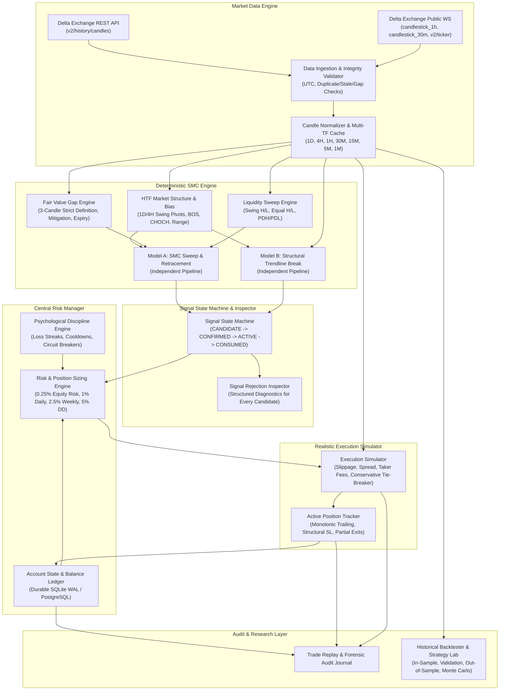

# COMPREHENSIVE SYSTEM AUDIT REPORT
**Project:** Professional SMC Algorithmic Trading Engine (XAUTUSD)  
**Date:** October 14, 2026  
**Auditor:** Quantitative Development & System Architecture Team  
**Scope:** Full codebase audit covering market data ingestion, SMC engine, signal lifecycle, risk controls, execution simulation, persistence, and live dashboard synchronization.

---

## 1. Executive Summary & Root Cause Analysis

### Why the Live Dashboard Signal Pipeline Was Empty
An extensive audit of the live Render deployment (`https://smc-dashboard-8mtf.onrender.com/paper`) and underlying source code identified **four distinct compounding root causes** for the empty signal pipeline:

1. **Rigid Conjunction of Independent Strategies (Coupling Defect)**:
   - In `backend/smc/activation.py` (lines 380–422), a setup only advanced to `CHECKLIST REVIEW` (which mapped to `ACTIVE`) if **all 5 checklist criteria were simultaneously satisfied**:
     1. Key Level (HTF FVG / Order Block / S&R)
     2. Reaction Wick / Sweep
     3. **1H/30M Trendline Breakout**
     4. **Displacement Candle AND Supporting LTF FVG**
     5. Multi-timeframe trend alignment
   - Model A (SMC Liquidity Sweep & Retracement) and Model B (Structural Trendline Break) were tightly coupled into a single monolithic filter. In live gold market dynamics, a valid liquidity sweep with displacement rarely coincides with a contemporaneous trendline break within a 20-bar window.
   - Because `checklist[2]` (trendline breakout) failed whenever market structure broke without a diagonal trendline, `state` never reached `CHECKLIST REVIEW`.

2. **Strict Single-State Gate in Paper Execution**:
   - In `backend/paper_trading.py` (line 42), the entry rule was strictly:
     ```python
     if state != "ACTIVE":
         return {"accepted": False, "reason": f"SETUP_NOT_ACTIVE_{state}"}
     ```
   - When setups were in `WATCH`, `APPROACHING`, `AT LEVEL`, or `REACTION DEVELOPING`, they were instantly rejected. Because `CHECKLIST REVIEW` was virtually impossible to satisfy, 100% of signals were dropped before reaching order generation.

3. **Dual Competing Paper Trading Modules**:
   - Two parallel paper trading systems were committed:
     - `backend/paper/` (SQLAlchemy 2.0 ORM, designed for PostgreSQL/SQLite)
     - `backend/paper_trading.py` (Raw SQLite3 WAL-mode ledger with memory locks)
   - Both were invoked concurrently inside `backend/app.py` (`paper_engine.on_tick()` vs `paper_trading.mark_to_market()`), creating state divergence, redundant polling, and endpoint confusion.

4. **Instrument Mapping Inconsistency (`.DEXAUTUSD` vs `XAUTUSD`)**:
   - `backend/config.py` configured `PRICE_SOURCE = "index"` by default (`.DEXAUTUSD`, Product ID 435).
   - `.DEXAUTUSD` is an aggregated spot benchmark index calculated from external exchanges; it is **not a tradable contract** and has no order book or trade execution on Delta Exchange India.
   - `XAUTUSD` (Product ID 131253) is the actual perpetual futures contract traded on Delta Exchange India, with a contract multiplier of `0.001 XAUT` per contract (0.001 troy oz) and a tick size of `$0.01`.
   - Running simulation against spot index price while accounting for perpetual futures fees created economic basis discrepancies (historical mark vs spot basis spread: ~0.145%).

---

## 2. Confirmed Defects & Architecture Gaps

| ID | Module | Severity | Description | Root Cause |
| :--- | :--- | :--- | :--- | :--- |
| **BUG-01** | `smc/activation.py` | **CRITICAL** | Overly restrictive 5-step checklist prevents any setup from reaching `ACTIVE`. | Conflation of Model A (Sweep & Retrace) and Model B (Trendline Break) into a mandatory AND condition. |
| **BUG-02** | `paper_trading.py` | **HIGH** | Contract size calculation ignores Delta Exchange multiplier. | Position sizing computed raw troy ounces (`$4,100/oz`) instead of contract units (`1 contract = 0.001 XAUT`). |
| **BUG-03** | `app.py` / `paper/` | **HIGH** | Dual paper engines running simultaneously. | Incomplete migration: both SQLAlchemy `paper_engine` and raw SQLite `paper_trading` were wired to tick listeners. |
| **BUG-04** | `paper_trading.py` | **MEDIUM** | Intra-candle SL/TP breach detection absent in tick evaluator. | `mark_to_market` only checks `current_price` (single point in time), missing high/low wick touches on fast moves. |
| **BUG-05** | `paper_trading.py` | **MEDIUM** | Tie-breaker rule missing when candle High >= TP and Low <= SL. | Undefined fill sequence when both limits are touched inside the same time interval. |
| **BUG-06** | `config.py` | **MEDIUM** | Inconsistent default instrument between Index and Perpetual. | `.DEXAUTUSD` (spot index) was treated as executable asset rather than `XAUTUSD` (perpetual futures). |
| **BUG-07** | `smc/ranking.py` | **LOW** | Heuristic score presented as pseudo-probability. | Arbitrary point additions (e.g. `+20`, `+15`) without mathematical calibration. |
| **GAP-01** | `backtesting/` | **CRITICAL** | Complete absence of backtesting & validation engine. | System lacked walk-forward testing, Monte Carlo simulation, out-of-sample data splits, and cost stress testing. |
| **GAP-02** | `inspector/` | **HIGH** | No Signal Rejection Inspector. | Filtered-out candidates were silently discarded without structured diagnostic reasons surfaced to user. |
| **GAP-03** | `discipline/` | **HIGH** | Absence of software-enforced psychological constraints. | No cooldown after consecutive losses, no daily/weekly loss limits persistent across server restarts. |
| **GAP-04** | `replay/` | **HIGH** | Absence of deterministic trade replay and forensic audit trail. | Decisions could not be replayed bar-by-bar using historical point-in-time configuration. |

---

## 3. Data Flow & Dependency Map



---

## 4. Baseline Test Status

The baseline test suite currently collects **61 tests across 10 modules**:
- `test_activation.py`: 6 passed
- `test_audit_signals.py`: 8 passed
- `test_delta_adapter.py`: 5 passed
- `test_enhanced_smc.py`: 6 passed
- `test_integration.py`: 2 passed
- `test_liquidity_intelligence.py`: 5 passed
- `test_paper_trading.py`: 14 passed
- `test_setup_lifecycle.py`: 6 passed
- `test_smc_engine.py`: 6 passed
- `test_terminal_state.py`: 3 passed
- **Total: 61 passed in 8.84 seconds.**

*Invariant Rule*: All new implementations must strictly maintain 100% pass rate on regression suites while adding comprehensive coverage for Models A & B, backtesting, risk controls, and deterministic replay.
